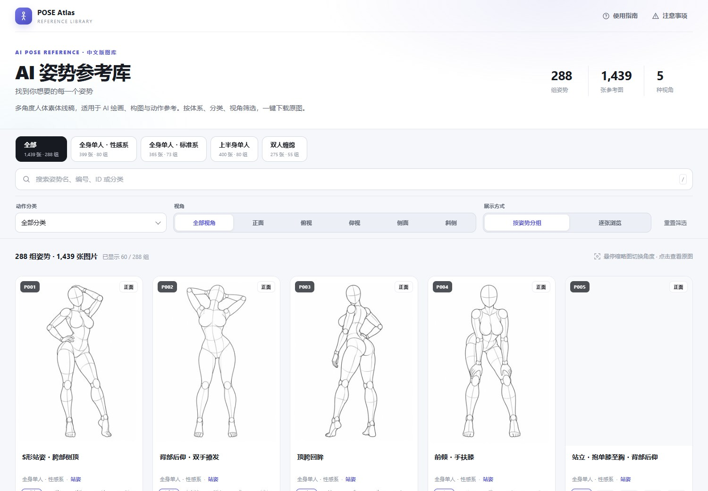
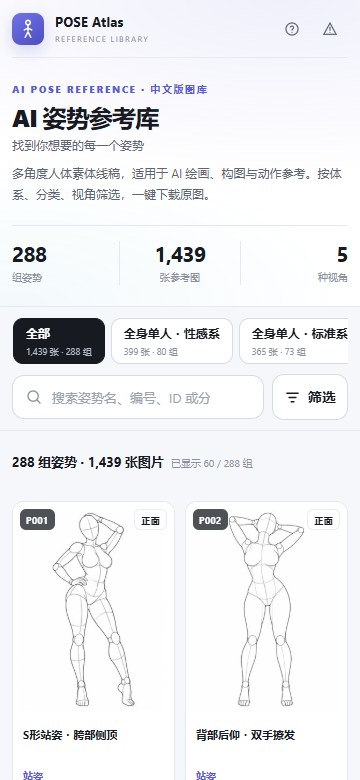

# AI Pose Gallery · 中文版

> 288 组 / 1439 张 AI 人体姿势参考图，日文数据完整汉化，附可直接部署的响应式静态画廊。



<details><summary>手机端预览</summary>



</details>

**原始站点：** <https://ai-pose-gallery.pages.dev/>
**原作者：** ギア（[X @giaaibusi](https://x.com/giaaibusi)）

---

## 这是什么

原站是一套面向 AI 绘画 / 3D / 摄影参考的姿势图库，元数据全部为日文，且不提供批量素材下载。本仓库做了三件事：

1. **全量镜像** —— 1439 条记录对应的 1439 张缩略图（JPG 300×400）与 1439 张原图（PNG 900×1200）全部落地，共 2878 个文件 / 659.5 MB。
2. **完整汉化** —— 日文字段逐条译为中文，覆盖 4 个体系、26 个分类、288 个姿势名、5 个视角，零遗漏。
3. **可用的前端** —— 零依赖响应式画廊，完整实现原站的分类筛选、多角度切换、分组浏览、灯箱导航与原图下载，并针对手机重新设计布局。

## 页面功能

- 4 个体系页签，显示各体系的图片数与姿势组数
- 姿势名、编号、ID、分类关键词搜索，支持 `/` 快速聚焦
- 动作分类、5 种视角组合筛选，可一键重置
- **按姿势分组 / 逐张浏览**双模式，分组卡片带多角度缩略图
- 悬停或点击缩略图切换主图角度，点击卡片打开灯箱
- 灯箱默认完整显示全图（不裁切），先显示缩略图、再加载 900×1200 原图，支持直接下载 PNG、复制 ID、新窗口打开
- **鼠标滚轮放大缩小**（以光标位置为中心，1×–8×），放大后可拖拽平移、双击或点击百分比徽标还原；切换角度/姿势自动复位
- `← / →` 切换角度，`↑ / ↓` 切换姿势，`Esc` 关闭；手机支持左右滑动
- PC 多列网格、手机双列网格，移动端筛选面板可展开/收起
- 使用指南与注意事项弹窗，页脚标注图片来源与原作者署名

## 更新记录

### 2026-10-30 灯箱完整显示 + 滚轮缩放（提交 `5ca7a31`）

**裁切根因**：`.viewer-stage` 原本是 `display:grid; place-items:center`，图片写了 `height:100%`，但这条隐式行按内容撑开、百分比高度解不出确定值，于是退化成按原图 900×1200 显示，`object-fit:contain` 完全失效，被舞台的 `overflow:hidden` 上下裁切。1280×900 视口实测：舞台 850×828，图片盒子 850×1133，纵向溢出 305px（上下各约 150px）。

- **默认完整显示**：`.viewer-panel` 显式声明 `grid-template-rows:minmax(0,1fr)`，`.viewer-image` 改为绝对定位铺满舞台，`contain` 生效；加载缩略图阶段同样是整图，原图到位后自动变清晰
- **滚轮缩放**：舞台内滚动鼠标滚轮以光标位置为锚点在 1×–8× 之间缩放，监听器带 `passive:false` 并 `preventDefault`，缩放时页面不再跟着滚动
- **拖拽平移**：放大后按住左键拖动图片，平移量按当前可视范围 clamp（`applyZoom` 内计算 `maxX/maxY`），不会拖进空白区域；只响应鼠标指针，手机端左右滑动切角行为不变
- **还原**：双击在 250% 与 100% 间切换；右下角新增百分比徽标，点击一键还原；切换角度、切换姿势、重新打开灯箱都会自动复位到 1×
- **窗口尺寸变化**时自动重新 clamp 平移量，避免缩放状态下改窗口造成偏移越界
- 灯箱内键盘提示、使用指南弹窗与本 README 的功能列表同步更新

未包含：手机端双指缩放（与「左右滑动切角」手势冲突，暂未做）。滚轮缩放属于本仓库在原站之上新增的能力，原站灯箱没有缩放；页面其余交互与原站保持一致。

## SEO 与分享

页面内置了 SEO 与社交分享配置：

- 关键词化标题：`AI 姿势参考库｜288 组人体姿势 · 1439 张多角度参考图`
- 独立 description、keywords、author 与 `max-image-preview:large`
- Open Graph / Twitter Card 使用 1200×630 的 `og-cover.jpg`
- JSON-LD 结构化数据：`WebSite` + `ImageGallery`，声明语言、简介与页面主图
- `robots.txt` 放行全站
- 语义结构：单一 H1、分区 H2、卡片 H3；缩略图 `alt` 含姿势名与视角，图片懒加载

仓库内不含任何写死的站点域名：`canonical`、`og:url`、`sitemap.xml` 都已移除，`og:image` 与 `twitter:image` 改用根路径 `/og-cover.jpg`。代价是社交抓取器多数要求绝对 URL，分享卡片可能不显示封面。部署到自己的域名后，建议补回三处：

1. `index.html` 的 `<head>` 内加 `<link rel="canonical" href="https://你的域名/">`，并把 `og:image` / `twitter:image` 换成绝对地址；
2. 新建 `sitemap.xml`（`<loc>` 填绝对地址），在 `robots.txt` 追加 `Sitemap: https://你的域名/sitemap.xml`，并在 `<head>` 加回 `<link rel="sitemap" type="application/xml" href="/sitemap.xml">`；
3. 若同一站点绑了多个域名，`canonical` 只保留正式域名，避免重复收录。

## 数据规模

| 体系 | 条数 |
| --- | ---: |
| 全身单人・标准系 | 365 |
| 全身单人・性感系 | 399 |
| 上半身单人 | 400 |
| 双人缠绵 | 275 |
| **合计** | **1439** |

每条记录对应 5 个视角中的若干个：正面 / 斜侧 / 侧面 / 俯视 / 仰视。

## 目录结构

```
.
├── index.html              # 单页画廊（零依赖，需 HTTP 环境，见「本地预览」）
├── robots.txt              # 搜索引擎抓取规则
├── og-cover.jpg            # 1200×630 社交分享封面
├── vercel.json             # Vercel 构建与缓存配置
├── data/
│   ├── pose.json           # 原始日文数据（1439 条，未改动）
│   ├── pose-zh.json        # 中文数据（前端实际读取，含检索字段）
│   ├── meta.json           # 原始体系分类
│   ├── meta-zh.json        # 中文体系分类
│   └── translations.csv    # 日⇄中对照表（323 条，便于校对）
├── thumbs/                 # 缩略图 1439 张 JPG 300×400（22 MB）
├── img/                    # 原图 1439 张 PNG 900×1200（637 MB）
├── scripts/
│   ├── download.py         # 并发下载器（48 线程 / 断点续传 / 自动重试）
│   ├── i18n.py             # 日译中词典（唯一值去重后的 323 条译文）
│   ├── apply_translation.py# 回填译文，生成中文数据
│   ├── verify.py           # 校验文件完整性（存在性 / 大小 / 图片头）
│   └── build.sh            # 生成发布目录 dist/（Vercel 构建命令调用）
├── docs/                   # README 页面预览图
├── LICENSE
└── README.md
```

## 数据结构

`data/pose-zh.json` 字段说明：

| 字段 | 原日文字段 | 示例 | 说明 |
| --- | --- | --- | --- |
| `id` | — | `full_sexy_P001_front` | 唯一标识 |
| `体系` | `系統` | 全身单人・性感系 | 4 大类 |
| `姿势编号` | `ポーズ番号` | `P001` | 80 组编号 |
| `分类` | `分類` | 站姿 | 26 类动作 |
| `姿势名称` | `ポーズ名` | S形站姿・胯部侧顶 | 288 种描述 |
| `角度` | `アングル` | 正面 | 5 种视角 |
| `缩略图` | `サムネ` | `thumbs/…jpg` | 相对路径 |
| `原图` | `原寸` | `img/…png` | 相对路径 |
| `检索` | — | 拼接串 | 供前端模糊搜索 |

原始日文数据 `data/pose.json` 保持原样，字段名与站点接口一致，便于对照或回灌。

## 本地预览

画廊通过 `fetch` 读取 JSON，需要 HTTP 环境（直接双击 `index.html` 会被 CORS 拦截）：

```bash
python3 -m http.server 8000
# 打开 http://127.0.0.1:8000
```

页面支持体系/分类/视角组合筛选、关键词搜索、分组与逐张浏览、多角度缩略图、懒加载、灯箱滚轮缩放与拖拽平移、原图下载、键盘与触屏导航。

## 脚本用法

```bash
# 重新拉取全部图片（已存在的文件自动跳过，可反复执行）
python3 scripts/download.py
WORKERS=64 python3 scripts/download.py   # 调整并发

# 修改 scripts/i18n.py 中的译文后，重新生成中文数据
python3 scripts/apply_translation.py

# 校验 2878 个文件是否完整
python3 scripts/verify.py
```

## 部署到 Vercel

纯静态站点，无框架、无 npm 依赖，可以直接部署。仓库已附 `vercel.json`：框架预设 `Other`、构建命令 `bash scripts/build.sh`、输出目录 `dist`，并写好了缓存策略，Git 导入时基本不用手填构建参数。

**必须走 Git 导入，不要用 CLI 直传。** Vercel Hobby 计划用 CLI 上传时源文件总量上限 100 MB，本仓库 `img/` + `thumbs/` 约 668 MB，`vercel` 命令必然失败；Git 导入由 Vercel 自己克隆仓库，不受这条上限约束。

**步骤（GitHub 自动部署）**

1. 把本仓库推到 GitHub。单文件最大 917 KB，远低于 GitHub 的 100 MB 硬限制，无需 Git LFS；仓库总体约 668 MB，推送耗时较长属正常。
2. vercel.com → **Add New… → Project** → 找到该仓库 → **Import**。
3. 确认构建设置（`vercel.json` 已提供，面板里显示为空即可）：

   | 字段 | 值 |
   | --- | --- |
   | Framework Preset | `Other` |
   | Build Command | `bash scripts/build.sh` |
   | Output Directory | `dist` |
   | Install Command | 留空（无依赖） |

4. **Deploy**，约 1–3 分钟得到 `https://<项目名>.vercel.app`。
5. 之后每次 `git push` 自动重新发布；绑自定义域名在 **Settings → Domains**。

**限制核对**（本仓库实测：2897 个文件 / 约 668 MB / 最大单文件 917 KB）

| 项目 | Vercel 限制 | 本仓库 |
| --- | --- | --- |
| CLI 上传源文件总量 | Hobby 100 MB / Pro 1 GB | 约 668 MB，**超限**，故只能走 Git 导入 |
| CLI 部署文件数 | 15,000 个源文件 | 2897，通过 |
| 构建产物文件数 | 无硬性上限，受 45 分钟构建超时约束 | 2886，通过 |
| 构建机磁盘 | 32 GB | 源目录 + `dist/` 约 1.34 GB，通过 |
| 单个静态文件体积 | 远大于 917 KB | 通过 |

**可选：零构建直发根目录。** 想跳过拷贝步骤，把 `vercel.json` 精简成 `{"framework": null, "outputDirectory": "."}`，Vercel 直接发布仓库根目录，部署更快。代价是 `scripts/`、`docs/`、`README.md` 也会作为静态文件公开可访问。

**注意事项**

- `vercel.json` 已为 `img/`、`thumbs/` 配置一年强缓存（`immutable`），`data/` 缓存一天，HTML 每次回源校验，图片不会重复拉取。
- Hobby 计划 100 GB/月带宽：整站素材 668 MB、缩略图全量 22 MB。访问量上来后若触顶，建议把 `img/` 原图迁到对象存储（Cloudflare R2 / 阿里云 OSS），Vercel 只留 `index.html` + `data/` + `thumbs/`。
- Hobby 计划仅限个人非商业用途，内容需符合 Vercel 的使用政策。本图库含成人向姿势参考，上线前请自行确认条款，避免站点被下架。

## 内容提示

图库包含成人向姿势参考（部分分类名称涉及性行为术语），仅供艺术创作、动作参考与前端技术学习使用。请勿用于违法用途。未成年人请勿访问。

## 版权与致谢

- **图片与原始数据的著作权归原作者ギア所有**，来源地址见页首
- 本仓库仅为个人学习、汉化与静态站点实践存档，**不对图片主张任何权利**，也不构成对原作品的商业使用授权
- 若原作者认为本仓库侵犯其权益，请通过 Issue 联系，将立即删除相关内容
- `scripts/` 与 `index.html` 的代码以 MIT 协议开源（见 [LICENSE](LICENSE)），该协议**不覆盖** `img/`、`thumbs/` 与 `data/` 中的图片和原始数据
